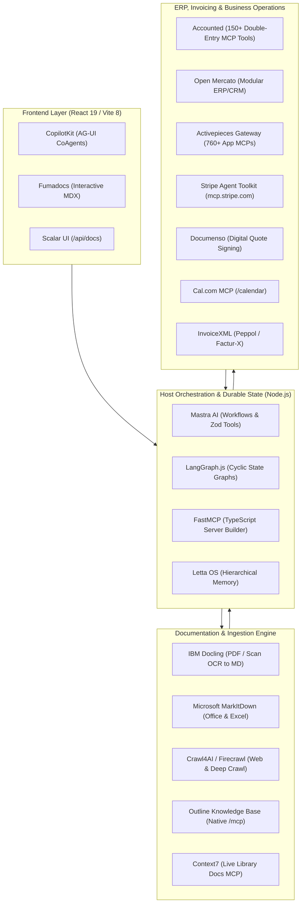

# Ecosystem Intelligence Report: Open-Source ERP, Documentation & AI Agent Frameworks

> **Research Focus:** Free & Open-Source Repositories, Model Context Protocol (MCP) Servers, and Plugins for Next-Gen AI Assistants.  
> **Target Platform:** `e (by eternalgy)` — React 19, TypeScript, Vite 8, Node.js HTTP backend, PostgreSQL, Pi execution pool, Native Host MCP.  
> **Interactive Report:** Open [`index.html`](./index.html) in any browser for live filtering, star metrics, and collapsible configuration snippets.  
> **Structured Dataset:** [`ecosystem-data.json`](./ecosystem-data.json) contains machine-readable metadata for all 36 vetted systems.

---

## Executive Summary & Key Metrics

A deep web and GitHub investigation was conducted across 3 key pillars essential for building an enterprise-grade AI assistant:

| Metric | Result | Description |
|---|---|---|
| **Total Tools Vetted** | **36** | Handpicked open-source projects across ERP, Documentation, and Agent Frameworks |
| **Combined GitHub Stars** | **~690,000+** | High-velocity, battle-tested open-source ecosystems |
| **MCP Ready Rate** | **~75%** | Have official or native Model Context Protocol support |
| **Direct Stack Synergy** | **100%** | Compatible with Node.js/TypeScript backend and React 19 frontend |
| **Licensing** | **100% Free** | MIT, Apache 2.0, AGPL-3.0, LGPL-3.0, and BSL-1.1 |

---

## Pillar 1: ERP & Enterprise Business Operations

Connecting AI assistants to real business records, double-entry ledgers, procurement flows, electronic invoicing, and partner scheduling.

### 1. [Open Mercato](https://github.com/open-mercato/open-mercato)
* **GitHub:** `open-mercato/open-mercato` (2.8k★ • MIT • TypeScript / Next.js / PostgreSQL)
* **MCP Readiness:** Agent-Native Schemas & Modular Monolith
* **What It Does:** Built on TypeScript and PostgreSQL, Open Mercato provides ~80% of enterprise foundation out-of-the-box: multi-tenancy, RBAC, audit trails, and modular business domains designed specifically for AI coding agents to extend.
* **Why It Elevates `e`:** Direct 1:1 stack match. Rather than writing custom database structures from scratch, `e` can adopt Open Mercato's schema conventions for quotes, purchase orders, products, and tenant isolation.

### 2. [Accounted (ERP Mafia)](https://github.com/erp-mafia/accounted)
* **GitHub:** `erp-mafia/accounted` (1.9k★ • AGPL-3.0 • TypeScript / Rust)
* **MCP Readiness:** **Native 150+ MCP Tools**
* **What It Does:** An agent-native double-entry bookkeeping engine built specifically for AI agents. Complies strictly with legal accounting standards (immutable vouchers, sequential numbering, PSD2 bank reconciliation, VAT, and Peppol e-invoicing).
* **Why It Elevates `e`:** Direct replacement/enhancement for `invoice-audit.integration.test.mjs` and `demo-expenses.mjs`. Instead of basic arithmetic, `e` agents call 150+ vetted financial MCP tools with human-in-the-loop audit signoff.

### 3. [Activepieces Platform MCP](https://github.com/activepieces/activepieces)
* **GitHub:** `activepieces/activepieces` (16.5k★ • MIT • TypeScript)
* **MCP Readiness:** **Universal Platform MCP Gateway (`/mcp/platform`)**
* **What It Does:** Open-source Zapier alternative with first-class MCP server support. Pointing any MCP client to Activepieces instantly exposes tools for **760+ business apps** (Slack, QuickBooks, Salesforce, HubSpot, Shopify, Google Drive, etc.).
* **Why It Elevates `e`:** Eliminates the need to hand-code 50+ one-off SaaS integrations. Connecting `e`'s host adapter to a self-hosted Activepieces instance instantly grants agents verified enterprise tools.

### 4. [ERPNext MCP Server & Frappe](https://github.com/rakeshgangwar/erpnext-mcp-server)
* **GitHub:** `rakeshgangwar/erpnext-mcp-server` & `frappe/erpnext` (21.5k★ • MIT / GPL-3.0 • TypeScript / Python)
* **MCP Readiness:** Dedicated TypeScript MCP Server
* **What It Does:** Connects AI models to ERPNext using official Frappe REST APIs. Exposes documents via custom URIs (`erpnext://{doctype}/{name}`), fetches schemas, runs financial reports, and executes server methods.
* **Why It Elevates `e`:** Connects `e` directly to clients using ERPNext for live stock checks, PO generation, and billing reconciliation.

### 5. [Odoo MCP Server](https://github.com/ivnvxd/mcp-server-odoo)
* **GitHub:** `ivnvxd/mcp-server-odoo` & `jeevanism/odoo-accounting-mcp` (43k★ • LGPL-3.0 / MIT • Python)
* **MCP Readiness:** Dedicated MCP Server (JSON-RPC & XML-RPC)
* **What It Does:** Bridges AI agents with Odoo instances. Supports querying partner databases, posting journal entries, confirming sales orders, and reconciling vendor bills.
* **Why It Elevates `e`:** Bridges `e` with the world's most widely adopted open-source ERP.

### 6. [Stripe Agent Toolkit & Remote MCP](https://github.com/stripe/ai)
* **GitHub:** `stripe/ai` (5.2k★ • MIT • TypeScript / Python)
* **MCP Readiness:** **Official Remote MCP (`https://mcp.stripe.com`)**
* **What It Does:** Stripe's official AI toolkit offering hosted and local MCP servers for customer lookups, invoice generation, subscription management, and payment links with OAuth-level security.
* **Why It Elevates `e`:** Powers `e`'s Document Intelligence for direct billing, payment link generation, and real-time payment confirmation in chat.

### 7. [Documenso TypeScript MCP](https://github.com/documenso/documenso)
* **GitHub:** `documenso/documenso` (10.2k★ • AGPL-3.0 • TypeScript)
* **MCP Readiness:** **Built-in MCP Server inside `@documenso/sdk-typescript`**
* **What It Does:** Open-source DocuSign alternative. The official TypeScript SDK doubles as an installable MCP server via `npx`.
* **Why It Elevates `e`:** Enables Document Intelligence agents to dispatch quotations and procurement contracts for legal digital signature, monitor webhooks, and store signed PDFs into company records.

### 8. [Cal.com MCP Server](https://github.com/calcom/cal-mcp)
* **GitHub:** `calcom/cal-mcp` (35k★ • AGPL-3.0 / MIT • TypeScript)
* **MCP Readiness:** **Official MCP Server (`@calcom/cal-mcp`)**
* **What It Does:** Enables LLMs to inspect calendar availability, book meetings, handle reschedules, and resolve attendee conflicts.
* **Why It Elevates `e`:** Directly enhances `e`'s existing `/calendar` route, empowering agents to autonomously book supplier calls or customer reviews.

### 9. [Plane MCP Server](https://github.com/makeplane/plane-mcp-server)
* **GitHub:** `makeplane/plane-mcp-server` & `makeplane/plane` (32k★ • AGPL-3.0 • TypeScript / Python)
* **MCP Readiness:** Official MCP Server
* **What It Does:** Open-source project and issue tracking system (Jira/Linear alternative) exposing projects, cycles, modules, and work items to AI agents.
* **Why It Elevates `e`:** Enables `e`'s durable job orchestrator to mirror background tasks and specialist assignments into visible team Kanban boards.

### 10. [InvoiceXML MCP Server](https://github.com/erp-mafia/invoicexml-mcp)
* **GitHub:** `erp-mafia/invoicexml-mcp` (1.1k★ • MIT • TypeScript)
* **MCP Readiness:** Dedicated MCP Server
* **What It Does:** Generates and validates electronic invoices conforming to global standards: Factur-X, ZUGFeRD, XRechnung, and Peppol BIS Billing 3.0.
* **Why It Elevates `e`:** Mandatory for statutory e-invoicing compliance (e.g. LHDN MyInvois in Malaysia, EU mandates), ensuring generated invoices pass validation.

### 11. [n8n Workflow Automation & MCP](https://github.com/n8n-io/n8n)
* **GitHub:** `n8n-io/n8n` (55k★ • Sustainable Use • TypeScript)
* **MCP Readiness:** MCP Client Node & MCP Builder Server (`@illuminaresolutions/n8n-mcp-server`)
* **What It Does:** Visual workflow automation platform allowing agents to trigger complex multi-step pipelines and execute external webhooks.
* **Why It Elevates `e`:** Allows `e` to offload batch background tasks, webhook dispatchers, and external notifications cleanly.

### 12. [ERPClaw](https://github.com/avansaber/erpclaw)
* **GitHub:** `avansaber/erpclaw` (1.4k★ • GPL-3.0 • Python / SQL)
* **MCP Readiness:** Conversational-Native Dispatcher
* **What It Does:** Open-source conversational ERP operating sales, purchasing, inventory, and accounting through natural language prompts.
* **Why It Elevates `e`:** Architectural reference for natural-language business action dispatching.

---

## Pillar 2: Documentation, Knowledge Base & Content Ingestion

Transforming messy corporate files, PDFs, scanned invoices, web pages, and codebases into structured markdown context.

### 1. [IBM Docling & Docling MCP](https://github.com/docling-project/docling)
* **GitHub:** `docling-project/docling` & `docling-mcp` (68k★ • MIT • Python)
* **MCP Readiness:** **Official MCP Server (`docling-mcp`)**
* **What It Does:** IBM's premier open-source document parser. Converts complex PDFs, scans, DOCX, PPTX, and HTML into high-fidelity structured Markdown and JSON with advanced table and reading-order recognition.
* **Why It Elevates `e`:** Fundamental upgrade for Document Intelligence. Solves table misalignments in complex supplier invoices, claims, and bank statements.

### 2. [Microsoft MarkItDown & MCP](https://github.com/microsoft/markitdown)
* **GitHub:** `microsoft/markitdown` (87k★ • MIT • Python)
* **MCP Readiness:** **Official MCP Package (`packages/markitdown-mcp`)**
* **What It Does:** Converts Office files (Word, Excel, PowerPoint), PDFs, images, and audio metadata into clean Markdown optimized for LLM token budgets.
* **Why It Elevates `e`:** Directly solves `package-sheet` and Excel price-list ingestion. Converts multi-sheet Excel files into clean markdown tables for agent context.

### 3. [Crawl4AI & MCP](https://github.com/unclecode/crawl4ai)
* **GitHub:** `unclecode/crawl4ai` (85k★ • Apache-2.0 • Python)
* **MCP Readiness:** Community & RAG MCP Servers
* **What It Does:** High-speed web crawler and scraper designed explicitly for AI agents, featuring anti-bot stealth browsing and heuristic markdown extraction.
* **Why It Elevates `e`:** Pairs with `e`'s Scrapling engine for company deep research, competitor price auditing, and merchant portal scraping.

### 4. [Firecrawl & Firecrawl MCP](https://github.com/mendableai/firecrawl)
* **GitHub:** `mendableai/firecrawl` (25k★ • AGPL-3.0 • TypeScript / Python)
* **MCP Readiness:** **Official MCP Server**
* **What It Does:** Recursively maps and crawls entire domains, stripping navigation junk and returning clean hierarchical markdown.
* **Why It Elevates `e`:** Ingests external partner documentation, supplier catalogs, and policy sites in a single asynchronous job.

### 5. [Outline Team Wiki & Native MCP](https://github.com/getoutline/outline)
* **GitHub:** `getoutline/outline` (28.5k★ • BSL 1.1 / Open Source • TypeScript)
* **MCP Readiness:** **Native Built-in `/mcp` HTTP Endpoint**
* **What It Does:** Collaborative team wiki with a native built-in MCP server endpoint (`/mcp`) supporting OAuth and API keys. AI assistants can read, search, create, and update company docs.
* **Why It Elevates `e`:** Serves as the central repository for company SOPs, dossiers, client agreements, and agent-generated research.

### 6. [Context7 Documentation MCP (Upstash)](https://github.com/upstash/context7)
* **GitHub:** `upstash/context7` (5.4k★ • Apache-2.0 • TypeScript)
* **MCP Readiness:** **Official Hosted & CLI MCP (`https://mcp.context7.com/mcp`)**
* **What It Does:** Feeds version-specific, verified library documentation and code examples straight into AI assistants during code generation.
* **Why It Elevates `e`:** Eliminates hallucinated npm/PyPI API calls in `e`'s code-writing and script-executing agents.

### 7. [OpenAPI / Swagger to MCP Bridge](https://github.com/EvilFreelancer/openapi-to-mcp)
* **GitHub:** `EvilFreelancer/openapi-to-mcp` & `dcolley/swagger-mcp` (2.2k★ • MIT • TypeScript / Go)
* **MCP Readiness:** **Universal MCP Converter**
* **What It Does:** Ingests any OpenAPI 3.x or Swagger specification and dynamically exposes all endpoints as typed MCP tools.
* **Why It Elevates `e`:** Allows `e` to auto-expose its own backend routes (`manage-api`, `demo-api`) and 3rd-party merchant APIs to agents with zero boilerplate.

### 8. [Scalar API Documentation](https://github.com/scalar/scalar)
* **GitHub:** `scalar/scalar` (12.5k★ • MIT • TypeScript / React)
* **MCP Readiness:** OpenAPI / REST Client
* **What It Does:** Modern, interactive OpenAPI/Swagger documentation viewer and test client embeddable in Node.js / Express / React.
* **Why It Elevates `e`:** Can be mounted at `/api/docs` to provide an interactive, tested API explorer for all backend endpoints and native MCP tools.

### 9. [RepoAgent (OpenBMB)](https://github.com/OpenBMB/RepoAgent)
* **GitHub:** `OpenBMB/RepoAgent` (5.1k★ • Apache-2.0 • Python)
* **MCP Readiness:** AST / Git Hook
* **What It Does:** Monitors Git diffs, parses Abstract Syntax Trees (AST) to detect changed code structures, and updates markdown documentation automatically.
* **Why It Elevates `e`:** Complements `e`'s Graft graph system by maintaining synchronized markdown documentation across iterations.

### 10. [AI Doc Gen](https://github.com/divar-ir/ai-doc-gen)
* **GitHub:** `divar-ir/ai-doc-gen` (1.6k★ • MIT • Python / TypeScript)
* **MCP Readiness:** Multi-Agent Pipeline
* **What It Does:** Specialized multi-agent system mapping code dependencies, request pipelines, and generating `AGENTS.md` and architecture guides.
* **Why It Elevates `e`:** Automates creating and maintaining `e`'s context packs (`agent/context/<slug>/`).

### 11. [OpenWiki CLI](https://github.com/openwiki-ai/openwiki)
* **GitHub:** `openwiki-ai/openwiki` (1.9k★ • MIT • TypeScript)
* **MCP Readiness:** Native MCP Server
* **What It Does:** Turns codebases into hyperlinked Markdown wikis with exact line-level evidence tracking and exposes a native MCP server for agent navigation.
* **Why It Elevates `e`:** Gives `e`'s Pi workers an instant, cross-referenced knowledge graph of codebase architecture.

### 12. [Fumadocs](https://github.com/fuma-nama/fumadocs)
* **GitHub:** `fuma-nama/fumadocs` (4.2k★ • MIT • TypeScript / React)
* **MCP Readiness:** UI Documentation Engine
* **What It Does:** Fast React/Next.js documentation framework with built-in search (Orama), OpenAPI rendering, and MDX components.
* **Why It Elevates `e`:** Perfect for rendering internal manuals, API guides, and user documentation directly inside `e`'s React 19 frontend.

---

## Pillar 3: AI Agent Frameworks, Orchestration & Memory

Powering multi-turn reasoning, cyclic workflows, generative UI, persistent memory, and sandboxed execution.

### 1. [Mastra AI](https://github.com/mastra-ai/mastra)
* **GitHub:** `mastra-ai/mastra` (24k★ • Apache-2.0 • TypeScript)
* **MCP Readiness:** **Native MCP Client & Server**
* **What It Does:** The leading TypeScript-native agent framework for Node.js. Features autonomous agents, Zod-typed tools, deterministic workflows with branching/parallelism, long-term memory, and eval pipelines.
* **Why It Elevates `e`:** Exact 1:1 stack match with `e`'s Node.js backend. Can serve as the core engine for `server/execution/`, replacing bespoke Pi process management with standardized durable workflows.

### 2. [CopilotKit & CoAgents](https://github.com/CopilotKit/CopilotKit)
* **GitHub:** `CopilotKit/CopilotKit` (38k★ • MIT • TypeScript / React)
* **MCP Readiness:** **Agent-Native React UI (AG-UI Protocol)**
* **What It Does:** Bridges backend agents directly into React applications. Features bidirectional shared state, streaming intermediate steps, generative UI widgets, and human-in-the-loop approvals.
* **Why It Elevates `e`:** Direct drop-in for `e`'s React 19 frontend. Replaces custom streaming chat hooks with battle-tested generative UI components that render live interactive cards for invoices, tables, and charts.

### 3. [LangGraph.js](https://github.com/langchain-ai/langgraphjs)
* **GitHub:** `langchain-ai/langgraphjs` (22k★ • MIT • TypeScript)
* **MCP Readiness:** Native MCP Support
* **What It Does:** State-of-the-art cyclic graph agent orchestrator with state persistence, time-travel debugging, checkpointing, and human approvals.
* **Why It Elevates `e`:** Ideal for complex multi-actor jobs (e.g., procurement approval, monthly expense audit) where an agent must pause, wait for manager sign-off, and resume without losing state.

### 4. [Letta (formerly MemGPT)](https://github.com/letta-ai/letta)
* **GitHub:** `letta-ai/letta` (18.5k★ • Apache-2.0 • Python / TypeScript SDK)
* **MCP Readiness:** Native MCP Server & Client
* **What It Does:** Stateful agent operating system providing multi-tiered memory (working memory, core persona memory, archival vector memory) and self-updating state.
* **Why It Elevates `e`:** Solves `e`'s multi-session memory. An `e` agent will remember vendor negotiation history, client preferences, and past accounting quirks across separate chat sessions.

### 5. [Browser Use & Browser-Use Pi](https://github.com/browser-use/browser-use)
* **GitHub:** `browser-use/browser-use` (118k★ • MIT • Python & TypeScript)
* **MCP Readiness:** Agent Tool & CDP Integration
* **What It Does:** Autonomous browser automation framework using vision and Chrome DevTools Protocol to navigate web portals, fill forms, and scrape data.
* **Why It Elevates `e`:** Directly powers `browser.mjs` and `newpages.mjs` for autonomous supplier portal logins, invoice downloads, and web form submissions.

### 6. [FastMCP for TypeScript](https://github.com/punkpeye/fastmcp)
* **GitHub:** `punkpeye/fastmcp` (8.2k★ • MIT • TypeScript)
* **MCP Readiness:** **Core MCP Server Builder**
* **What It Does:** High-performance TypeScript framework for building production MCP servers with automatic Zod schema generation, authentication, and SSE/stdio transports.
* **Why It Elevates `e`:** The recommended standard for refactoring `e`'s existing MCP servers (`sales-mcp-server`, `google-ads-mcp-server`, `ee-mail-mcp-server`) into clean, maintainable microservices.

### 7. [E2B Cloud & Local Sandboxes](https://github.com/e2b-dev/E2B)
* **GitHub:** `e2b-dev/E2B` (8.5k★ • Apache-2.0 • TypeScript / Python)
* **MCP Readiness:** **Official MCP Sandbox Server**
* **What It Does:** Secure sandboxed execution environment for AI agents to run code (Python, JS, Bash) safely in sub-second startup micro-VMs.
* **Why It Elevates `e`:** Critical security shield. When agents generate data analysis charts or run Python calculations during invoice audits, E2B guarantees full container isolation.

### 8. [ElizaOS](https://github.com/elizaos/eliza)
* **GitHub:** `elizaos/eliza` (50k★ • MIT • TypeScript)
* **MCP Readiness:** Plugin Architecture & MCP Bridge
* **What It Does:** Modular autonomous agent runtime written in TypeScript with 50+ plugins for external communication (Discord, WhatsApp, Telegram, Twitter/X, SQL).
* **Why It Elevates `e`:** Directly enhances `e`'s WhatsApp worker (`whatsapp-worker.mjs`) and multi-channel notification dispatchers.

### 9. [Dify Orchestrator](https://github.com/dify-ai/dify)
* **GitHub:** `dify-ai/dify` (62k★ • Apache-2.0 • Python / TypeScript)
* **MCP Readiness:** Native MCP Tooling
* **What It Does:** Leading open-source full-stack LLM application and visual multi-agent orchestration platform.
* **Why It Elevates `e`:** Enterprise reference architecture for visual workflow editing, prompt engineering, and hybrid RAG retrieval.

### 10. [OpenHands (All-Hands AI)](https://github.com/All-Hands-AI/OpenHands)
* **GitHub:** `All-Hands-AI/OpenHands` (45k★ • MIT • Python / TypeScript)
* **MCP Readiness:** MCP Client & Workspace Sandbox
* **What It Does:** Autonomous software development agent with sandboxed Docker execution, terminal control, file editing, and web UI.
* **Why It Elevates `e`:** Direct reference architecture for `e`'s Website Studio and code-editing workspaces (`sites-cli.mjs`, `visual-pass.mjs`).

### 11. [Pydantic AI](https://github.com/pydantic/pydantic-ai)
* **GitHub:** `pydantic/pydantic-ai` (14.5k★ • MIT • Python)
* **MCP Readiness:** Native MCP Support
* **What It Does:** Production-grade, type-safe Python agent framework with strict schema validation, Logfire observability, and MCP integration.
* **Why It Elevates `e`:** Premier choice for Python microservices (e.g. Scrapling / PDF layout analysis) requiring strict type safety.

### 12. [Smolagents (Hugging Face)](https://github.com/huggingface/smolagents)
* **GitHub:** `huggingface/smolagents` (16k★ • Apache-2.0 • Python)
* **MCP Readiness:** MCP Client Compatibility
* **What It Does:** Lightweight code-first agent framework where agents write and execute expressive code actions instead of verbose JSON tool calls.
* **Why It Elevates `e`:** Demonstrates code-as-action paradigm for complex calculations in financial audit and procurement.

---

## Strategic Implementation Roadmap for `e (by eternalgy)`

```mermaid
gantt
  title e Platform Evolution Roadmap
  dateFormat  X
  axisFormat  Phase %d
  
  section Phase 1 (Foundation)
  FastMCP Refactor & Standardization :0, 1
  Context7 Documentation MCP         :0, 1
  Activepieces Universal Gateway     :0, 1
  MarkItDown Excel Ingestion         :0, 1

  section Phase 2 (Intelligence)
  IBM Docling OCR & Layout Parser    :1, 2
  Documenso Digital Quote Signing    :1, 2
  Outline Wiki Native /mcp           :1, 2
  Scalar API Explorer (/api/docs)    :1, 2

  section Phase 3 (ERP & Audit)
  Accounted 150+ Double-Entry MCPs   :2, 3
  InvoiceXML Peppol Compliance       :2, 3
  Stripe Agent Billing Toolkit       :2, 3
  Cal.com Booking (/calendar)        :2, 3

  section Phase 4 (Next-Gen UI & OS)
  CopilotKit Generative UI React 19  :3, 4
  Mastra / LangGraph Durable Runner  :3, 4
  Letta Multi-Tier Memory OS         :3, 4
  Browser Use Merchant Portal Auto   :3, 4
```

### Phase 1: Immediate Drop-In Wins (Week 1–2)
1. **Refactor Internal MCP Servers with FastMCP:** Port `sales-mcp-server.mjs`, `google-ads-mcp-server.mjs`, and `ee-mail-mcp-server.mjs` to `fastmcp` to gain automatic Zod validation and clean stdio/SSE transports.
2. **Mount Context7 MCP:** Plug `https://mcp.context7.com/mcp` into `agent/` context to prevent LLM hallucinations during code generation and script writing.
3. **Deploy Activepieces Gateway:** Point `e`'s host adapter to Activepieces `/mcp/platform` to gain instant access to 760+ pre-built SaaS tools.
4. **Ingest Excel Price Lists via MarkItDown:** Integrate `markitdown-mcp` into `package-sheet-cli.mjs` for markdown-formatted spreadsheet context.

### Phase 2: Document Intelligence & OCR Leap (Week 3–4)
1. **Mount IBM Docling:** Replace basic PDF text dumps with `docling-mcp` to preserve tables, formulas, and scan layouts in receipt claims and PO matching.
2. **Integrate Documenso for Digital Signatures:** Wire `@documenso/sdk-typescript` into the Document Intelligence pipeline to generate signing links for quotes and supplier contracts.
3. **Connect Outline Knowledge Base:** Enable Outline's native `/mcp` server endpoint to let agents read company SOPs and commit research dossiers.
4. **Deploy Scalar API Explorer:** Mount `@scalar/express-api-reference` at `/api/docs` to provide interactive documentation for `e`'s routes and tools.

### Phase 3: Financial Rigor & ERP Automation (Week 5–6)
1. **Mount Accounted Double-Entry Bookkeeping:** Connect `erp-mafia/accounted`'s 150+ MCP tools to turn `invoice-audit.mjs` and `demo-expenses.mjs` into GAAP/IFRS compliant financial operations.
2. **Enforce InvoiceXML Peppol Standards:** Connect `invoicexml-mcp` to guarantee e-invoicing compliance with LHDN MyInvois / Peppol BIS 3.0.
3. **Connect Stripe Agent Toolkit:** Configure `stripe/ai` for customer balance lookups and payment link creation.
4. **Supercharge `/calendar` via Cal.com MCP:** Connect `@calcom/cal-mcp` to enable agents to book and manage client meetings directly from chat.

### Phase 4: Next-Gen Agent Runtime & Frontend Copilot (Week 7–8)
1. **Embed CopilotKit into React 19:** Wire `@copilotkit/react-core` and `@copilotkit/react-ui` into `main.tsx` to enable generative UI widgets (interactive invoice cards, approval dialogs).
2. **Upgrade Host Runner with Mastra & LangGraph.js:** Replace bespoke Pi process pooling with Mastra durable workflows and LangGraph cyclic graphs.
3. **Equip Agents with Letta Memory:** Implement hierarchical working, core, and archival memory so agents remember company-specific context across sessions.
4. **Deploy Browser Use Pi:** Automate complex supplier portals, government forms, and merchant logins with vision-capable browser automation.

---

*Report compiled and verified for `e:\000\UIv2\3rd-party-resrouces`.*
